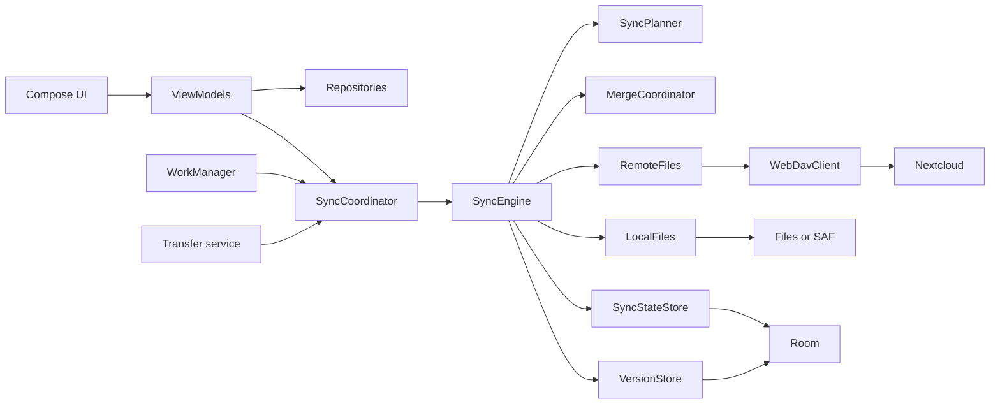

# Architecture

`SyncEngine` depends only on ports declared in `:core`. Room, Keystore, OkHttp, and Compose sit behind those ports. A unit test builds the engine with in-memory fakes and does not start Android.

## Process lifetime

Important decisions are read from Room at the start of a sync. The engine does not trust a previous in-memory scan.

- WorkManager keeps the periodic request across reboots.
- `CloudSyncApplication` and `BootReceiver` requeue transfers left in `RUNNING` and re-register each folder schedule.
- `CloudSyncTransferService` is a short-lived foreground service for a user-requested sync. The worker sets its own foreground notification for scheduled work.
- A `MergeSession` left in `READY_TO_UPLOAD` is uploaded again on the next sync of that folder. The local bytes are not replaced with the merge until that upload succeeds, unless the folder is download-only, in which case the result stays on the device and the server is not touched.

## Accounts

Each account id is the key for its credential file and for `fileKey` values (`accountId|remotePath`). Disconnecting an account deletes the Keystore blob, the Room rows that cascade from the account, and version rows for that account prefix. Files already written under the local root are left in place.

## Modules

See `CONTRIBUTING.md` for the module table. `:testing` holds the fakes used by the sync tests and is not shipped in the release APK as application code; it is a JVM test dependency.
